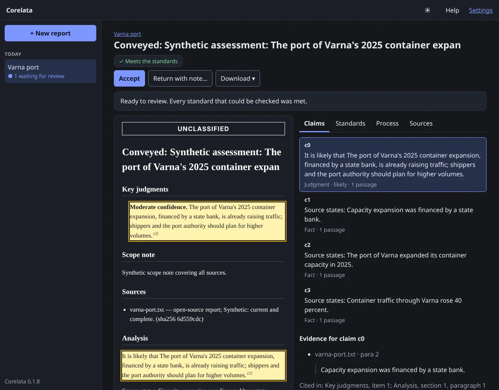

# Corelata

Standards-enforced intelligence report production with a full trace. An analyst supplies
source material and a statement of its intelligence value; Corelata gates the statement
against the sources, drafts an ICD 203-shaped assessment, reviews it for the reader, audits
it rule by rule against a replaceable standards pack, and delivers the report with every
claim linked to its evidence.

It runs on one Linux host under Docker Compose, needs no internet access, and talks only to your
own OpenAI-compatible model servers (vLLM, Ollama, TGI, a llama.cpp server, LM Studio). ICD 203
and ICD 206 ship as the base standards pack; you can tune it or replace it.

[](https://corelata.com/#demo)

Watch the [30-second walkthrough](https://corelata.com/#demo) or read a
[sample report](https://corelata.com/sample/) on [corelata.com](https://corelata.com).

## Requirements

To try it from this repository:

- Docker Engine 24 or newer with the Compose plugin 2.24 or newer (`docker compose version`);
- `git` and `make`;
- internet access for the first build, which downloads the base images and packages;
- about 2 GB of disk for the images.

The image is built for linux/amd64. On an arm64 machine (Apple silicon, for example) Docker
emulates it, which is slower but works where emulation is set up. The quick start needs no model
server: it uses a built-in synthetic model.

## Quick start

```sh
git clone https://github.com/Bonham-Technologies/corelata.git
cd corelata
make demo
```

`make demo` builds the app image (a few minutes the first time) and starts the stack with the
synthetic model. Open <http://127.0.0.1:8080>, create a project, upload a source (try
[`docs/examples/varna-port.txt`](docs/examples/varna-port.txt)), write a value statement such as
"Varna port capacity expansion matters to shippers" and choose **Write the report**. Corelata
checks the statement against the source, drafts, edits and audits the report, then opens it for
review. The synthetic model answers with placeholders, so the reports are structurally complete
but say nothing true; point Corelata at a real model server
([operator guide](docs/operator-guide.md)) to get real assessments.

`make demo-down` stops the demo and deletes its data.

## Next steps

- [Operator guide](docs/operator-guide.md): install the offline bundle on an air-gapped host,
  connect your model servers, tune the standards pack, back up, restore and upgrade.
- [Contributing](CONTRIBUTING.md): set up a development environment and open a pull request.
- [Trace format](docs/trace-format.md): what each report's trace records.
- [Design](docs/superpowers/specs/2026-10-12-corelata-v1-design.md) and
  [milestone history](docs/history.md): how Corelata got here, milestone by milestone.
- [Changelog](CHANGELOG.md): what changed since the last release.

## Development

    make db-up && make lint && make test   # Postgres 16 in Docker; ruff and pytest for engine and api; Vitest for web

Tests need `CORELATA_TEST_DATABASE_URL` (an admin URL; `make test-engine` sets it to the dev
database on 127.0.0.1:55433). The suite creates a throwaway database per session.

Scenario fixtures (`engine/corelata/bench/scenarios/*.yaml`) pin the pipeline's behaviour
against the synthetic model: sources, statement, expected gate verdict, failing rules per
iteration. They ship inside the package so `corelata bench` can play them against real models
(M6 in [docs/history.md](docs/history.md)). Add one when you change what a run does. The
real-model set (`engine/corelata/bench/scenarios-real/*.yaml`) states ranges and rule sets
instead; CI only checks that the real set loads and that `off-topic-sources` runs to an outcome on
the synthetic model (the other seven are only loaded).

## Licence

Corelata is licensed under the Apache License 2.0; see [LICENSE](LICENSE) and [NOTICE](NOTICE).
Contributions are welcome under the same terms: see [CONTRIBUTING.md](CONTRIBUTING.md) for how,
and [SECURITY.md](SECURITY.md) to report a vulnerability.
